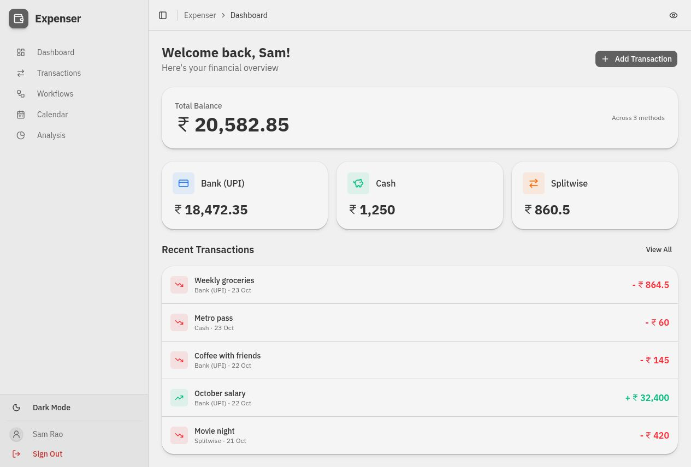

# Expenser

The web app is available at [expenser-rdp.vercel.app](https://expenser-rdp.vercel.app).

[Download the Expo Android app](https://github.com/wrestle-R/Expenser/releases/download/v2.1.0-preview/expenser-full.apk).

[Download Expenser Lite for Android](https://github.com/wrestle-R/Expenser/releases/download/v2.1.0-preview/expenser-lite.apk).

Personal transaction tracking on Android and the web.

Expenser records income and expenses across Bank, Cash, and Splitwise. The Android apps parse supported transaction SMS locally, use cloud parsing when local rules cannot resolve a message, and keep saved transactions and edits available offline.

Lite uses the same account and SMS import, with a focused transactions screen for adding, editing, searching and deleting transactions. It installs beside the full app and needs its own sign-in and notification access. Both downloads are Android preview builds; Lite supports ARM64 and ARMv7 phones.

## Desktop preview



The preview uses fictional sample data.

## Run locally

Web:

```bash
cd next
npm ci
npm run dev
```

Full Android app:

```bash
cd expo
npm ci
npm start
```

Lite:

```bash
cd lite
npm ci
npm start
```

See [Lite setup and release builds](lite/README.md). Mobile regression tests run with `npm test` from `expo/` or `lite/`.
