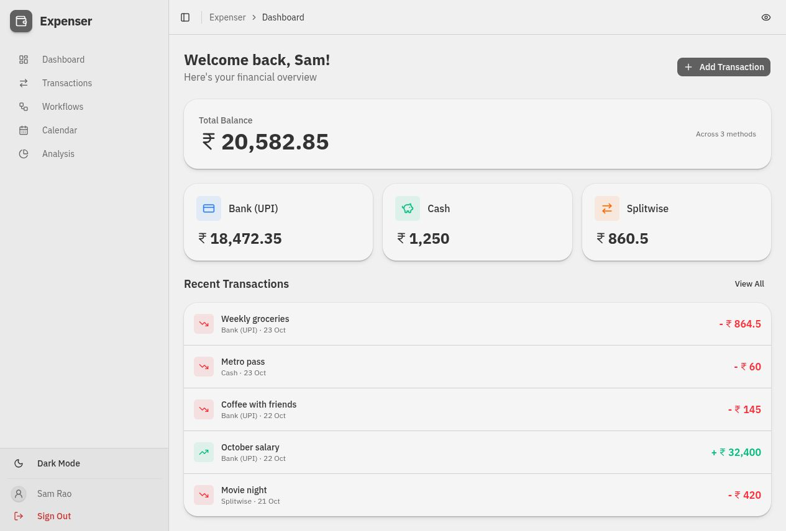

# Expenser

The web app is available at [expenser-rdp.vercel.app](https://expenser-rdp.vercel.app).

[Expenser 1.2.0 Android preview on Expo](https://expo.dev/accounts/russeldp/projects/expenser/builds/2b7ca403-4797-4a5b-896f-cbdf1cc788b9). Open the build page to install the APK before it expires on December 9, 2026. This preview adds Google sign-in and can import supported bank alerts in the background once you enable Android notification access.

The [previous full Android APK](https://github.com/wrestle-R/Expenser/releases/download/v2.2.0-preview/expenser-full.apk) and [Expenser Lite APK](https://github.com/wrestle-R/Expenser/releases/download/v2.1.0-preview/expenser-lite.apk) are available on GitHub.

Personal transaction tracking on Android and the web.

Expenser records income and expenses across Bank, Cash, and Splitwise. The Android apps parse supported transaction SMS locally, use cloud parsing when local rules cannot resolve a message, and keep saved transactions and edits available offline.

Workflows can repeat on selected weekdays at a saved time and time zone. Home shows today’s scheduled entries; “Not today” skips or undoes that day without stopping the schedule. Entries keep their scheduled timestamp, and the server checks due workflows every minute.

Lite uses the same account and SMS import, with a focused transactions screen for adding, editing, searching and deleting transactions. It installs beside the full app and needs its own sign-in and notification access. Lite supports ARM64 and ARMv7 phones.

## Desktop preview

The preview uses fictional sample data.
